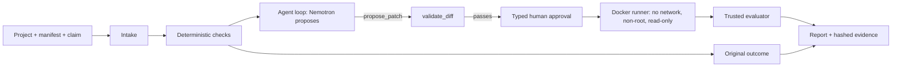

# ATLAS

ATLAS is a coding agent that audits machine-learning evaluation code for leakage. Given a small scikit-learn classification project and the claim it makes ("the classifier works on people absent from training"), it runs executable evidence checks, and when it finds a violation it asks an NVIDIA Nemotron model to propose a bounded revision of the evaluation code. **The model proposes; a deterministic evaluator decides.** Every candidate runs only in an isolated Docker runner, after a typed human approval, and is judged by the same trusted evaluator that judged the original. A lower score can be the honest result.

<!-- Sources for this section: PROJECT_BRIEF.md; AGENTS.md "Scope" and "Isolation"; docs/SPEC.md §9, §11. -->

- Outcome codes are exactly `VIOLATION_FOUND`, `NO_VIOLATION_FOUND`, `INCONCLUSIVE` and `NOT_SUPPORTED`. `NO_VIOLATION_FOUND` means every required check passed within the coverage shown; it does not say the claim is true.
- Status: hosted demo deployed on Streamlit Community Cloud and smoke-tested on both routes; public link at submission [TODO: demo URL]. Public repository URL [TODO: source needed].

## Headline results

All figures come from the project's own records; none is a benchmark of detection rates.

### Live run 6: the first complete live end-to-end success (2026-10-18)

`VIOLATION_FOUND` -> Nemotron proposes a fix -> human approval -> Docker -> `NO_VIOLATION_FOUND`.

| | |
| --- | --- |
| Project | `benchmarks/t01/s01_faulty` (synthetic) |
| Original | `VIOLATION_FOUND` |
| Revision 1 (`new_source`) | approved by the user, executed in Docker, judged `NO_VIOLATION_FOUND` |
| Checks FAIL -> PASS | `split.no_group_overlap`, `split.sampling_unit_disjoint`, `split.repeated_measures_rule`, `fit.state_dependencies_within_fold_train` (4) |
| Balanced accuracy, pooled | original 0.68125, candidate 0.675 (descriptive only; never part of an outcome) |
| Run end state | `BUDGET_EXHAUSTED`: revision 2 was rejected by `validate_diff` (`syntax_error`) and attempt 5 hit the 2-revision limit |
| Requests / cost | 5 requests, 0 retries, 0 schema failures; estimated $0.0190884 (provider-reported usage at listed prices; **not billing**) |

Source: TASKS.md T-06 "LIVE RUN 6"; STATUS.md. The candidate scored *lower*: After the four violations were removed, the pooled balanced accuracy was lower (0.68125 → 0.675); the difference is descriptive and is not attributed to a single cause.

The live runs ended differently, and all are recorded: run 1 two proposals rejected, no candidate executed; run 2 `ERROR` (`not_json`); run 3 declined approval (`NEEDS_INPUT`); run 3b `ERROR` (`incomplete`); run 4 both candidates `INCONCLUSIVE` (`KeyError: 'subject_id'`); run 5 `ERROR` (`not_json`); run 6 success above; run 7 (`har_flawed`, real UCI HAR data) found the violation, but both proposed revisions were rejected as malformed (double-escaped source), so no candidate ran (estimated $0.0268920, not billing); run 8 (`har_flawed`) found the violation again, both revisions were again rejected as double-escaped although the exact double-escape diagnostic was returned after revision 1, and it ended `ERROR` (`schema_failure: incomplete_length`; estimated $0.0251895, not billing). Across runs 7 and 8 Nemotron proposed the correct repair logic for har_flawed four times (subject-grouped folds; scaler and selector fit on training rows only) and returned it double-escaped four times, including after an exact diagnostic. ATLAS does not repair model output, so none of them ran, and there are no further live attempts on har_flawed: further prompt tuning until a run succeeds would select results (DECISIONS.md "Live runs 7-8 disposition (lead, 2026-10-20)"). Estimated total live spend, runs 1 to 8, the T-11 comparison and the hosted smoke test: about $0.185 ($0.1853826; not billing). Source: STATUS.md.

### UCI HAR: real data, a flawed protocol against a clean control

Both projects are **ATLAS-authored** on the public UCI HAR data (21 training subjects, 7,352 windows; the official test partition is never read). Same model family, different protocols.

| Project | Protocol | Outcome | Balanced accuracy, mean over development folds |
| --- | --- | --- | --- |
| `har_flawed` | random row-level folds; scaler and selector fit on all rows | `VIOLATION_FOUND` | 0.906 |
| `har_clean` | subject-grouped folds; everything fit inside each fold | `NO_VIOLATION_FOUND` | 0.875 |

The 0.906 against 0.875 gap is a **descriptive** comparison of two protocols, not a causal decomposition. ATLAS recomputes the flawed project's metric from its own predictions, so the reported-metric check correctly passes there; the inflation shows only against the clean control. The clean control's `split.no_window_overlap` passes only through documented containment (conditional, not independently verified). Source: `docs/T09_CONTAINMENT.md` §2, §3, §6; DECISIONS.md "Lead decisions, 2026-10-17" item 7.

### Does the agent add anything over the model alone? (T-11, development cases)

The same model (Nemotron) reading the same files with no executable checks, three trials per case, against ATLAS's deterministic audit, on our four development cases. These are **not held-out**: ATLAS's checks were built on them.

| | ATLAS (deterministic) | Nemotron alone (9 valid of 12 trials) |
| --- | --- | --- |
| Predeclared violations found | 8 of 8 assessable (1 more left `NOT_ASSESSED`: `split.no_window_overlap`) | 19 of 23 overall; 19 of 20 on the 8 ATLAS-assessable |
| False positives | 0 | 2 |
| False violations on the clean controls | 0 | 0 |
| Invalid replies (unscored) | none | 3 of 12 |
| Repeatability | deterministic by design (evaluated once per case here) | varied between trials |

On these small cases the model reading the code finds most of the same flaws, possibly helped by the flawed projects' own files, which describe their flaws in plain text. ATLAS's audit was evaluated once per case. What ATLAS adds is evidence you can re-run, no false positive in this comparison, and fixes verified by execution (live run 6), not seeing more. The comparison tests detection only. Source: `docs/EVALUATION.md` "Results (live, 2026-10-19)" (claims reviewed by Gemini); estimated cost $0.063, not billing.

### Safety controls and their reviews

- Typed approval bound to the snapshot and code hashes; a wrong or truncated confirmation declines. Docker-only execution, no host fallback. The trusted evaluator, holdout labels and pass criteria are immutable to the agent (AGENTS.md; SPEC §9-§10).
- Reviews: Gate 1 PASS (`runs/g1v3/review.md`, after earlier FAIL and NOT VERIFIED rounds); Gate 2 was the lead's decision record, not a review verdict (DECISIONS.md "2026-10-16 — T-06 slice 4 live-run decisions (lead)"); Gate 3 PASS (`runs/g3y/review.md`, after three FAIL rounds); Gate 4 FAIL (two P2), resolved by slices 4c-4h; combined review FAIL (three P2), re-verified and closed; T-06 accepted by the lead within its documented scope (`f059554`, on the code at `199a173`). The hosted build (T-12) passed Codex's security-and-spend review after two fix passes: review 1 found one P2 (the hosted flag did not guard local execution), review 2 with a fault-injection matrix (C1-C10) found two P2 (unguarded Docker maintenance entries; a partial headline after a render failure); all three were fixed and re-verified (DECISIONS.md "T-12 acceptance and merge (lead, 2026-10-19)"). Source: STATUS.md; TASKS.md T-06 "ACCEPTANCE".
- Tests: full suite on main, 2026-10-20: 1791 passed, 2 skipped (environment), with Docker required (`runs/relfix1/full.log`, git-ignored); the skips are the symlink-permission test on this host and an evidence-only motion capture.

## How ATLAS uses NVIDIA Nemotron on Nebius Token Factory

Model: `nvidia/nemotron-3-super-120b-a12b` (listed $0.30 / $0.90 per 1M input / output tokens, context 262,144), through the OpenAI-compatible Token Factory API at `https://api.tokenfactory.nebius.com/v1/`. Sources: DECISIONS.md "Initial model and response approach" and "T-06 slice 4 live-run decisions (lead)"; docs/SPEC.md §11.

- **Bounded loop.** At most 6 model requests, 12 tool operations, 2 candidate revisions, 5 active minutes per run, 30 s per candidate execution and a 60 s request timeout. Ceilings: 12,000 input tokens (an ATLAS estimate, not a guarantee) and 8,000 output tokens. No retry raises a cap.
- **Exact reply validation.** The model must return one raw JSON object (one action, no duplicate keys, no undeclared fields). Application-validated by strict Pydantic schemas, **not** provider-enforced structured output: no NVIDIA model on Nebius lists `json_mode` or `structured_outputs`. Reply text is never repaired or leniently parsed. Up to two consecutive schema failures get a corrective turn built from the schema and fixed text only, inside the 6-request budget.
- **Cost accounting.** Each request is reserved before it is sent; usage is validated before accounting; the run stops unsent if the next ceiling would pass the estimate cap of $0.0648 per run. At most $0.51 per run is authorized (the provider-enforced worst case, which ATLAS has not verified). Figures are estimates from provider-reported usage, **not billing**.
- **Pre-run model check.** Before any completion, one free authenticated `GET /models` must list the model with exactly the configured prices and context length, or the run aborts.
- **Roles.** In a bounded loop it chooses one typed action per reply: list the project's files (`list_project_files`), read one project file (`read_project_file`), inspect the original's recorded evidence for one check family (`inspect_evidence`: split integrity, fit provenance, independent metrics or temporal availability), propose a revision of the entry point (`propose_patch`: a unified `diff` or the complete `new_source`, with a rationale), or finish (`finish`, with a summary). ATLAS itself runs the deterministic checks before any model request and, after a typed human approval, executes an accepted revision in Docker and re-evaluates it; the model can do neither. `validate_diff` is the only gate for a proposal; the trusted evaluator is the only source of an outcome.

## Architecture



Source: docs/SPEC.md §6, §9-§11; docs/T09_CONTAINMENT.md §5.

| Mode | Executes | Model | Labelled |
| --- | --- | --- | --- |
| Local build (full) | Original and every candidate in the isolated Docker runner after typed approval | live (CLI, explicit authorization) or fixture | LIVE or NON-LIVE banner |
| Limited hosted (deployed on Streamlit Community Cloud and smoke-tested on both routes (2026-10-19); public at submission) | Nothing from a project; the original's findings come from a recorded, hash-verified trusted run; proposals are "not executed here" | one capped live session per visitor session; kill switch off by default | disclosed replay, "not executed here" |
| Fixture | Same loop with scripted model replies | none | NON-LIVE |

Source: docs/SPEC.md §13; docs/HOSTED_OPERATIONS.md §1. The hosted caps are $3.00 public ($1.00 per UTC day), $5.00 judge, $0.0648 and 6 requests per session, enforced in Neon Postgres; the caps are tested on a local PostgreSQL container, and the deployed app's smoke test (2026-10-19) reserved and settled its six requests in Neon (judge $0.0045216, public $0.0076857; estimates, not billing). No cap was reached on the host.

## Setup and running

Requirements: Windows with Docker Desktop (tested with Engine 29.8.2 on Windows 11 only), [uv](https://docs.astral.sh/uv/), Python 3.11 (pinned by `.python-version`).

```powershell
uv sync --locked
copy .env.example .env      # then edit .env; it is git-ignored. Never commit real values.
```

`.env` keys (`.env.example`): `NEBIUS_API_KEY` (a Token Factory key; live runs only), `NEBIUS_BASE_URL`, `ATLAS_MODEL_PRIMARY` (a model ID confirmed by `GET /models`), `ATLAS_MODEL_MODE` (`fixture` or `live`; fixture runs are labelled NON-LIVE). The live entry point reads only the key from `.env`; its model ID and base URL are fixed in code (SPEC §11).

**Offline audit, no model, no Docker** (deterministic; trusted fixtures only, run on the host, not isolated):

```powershell
uv run --locked python -m atlas.cli audit benchmarks/t01/s01_faulty --mode audit --runs-dir runs
```

**Fixture agent demo (NON-LIVE; no key, no spend; Docker Desktop must be running):**

```powershell
$env:ATLAS_MODEL_MODE = 'fixture'
uv run --locked python -m atlas.cli audit benchmarks/t01/s01_faulty --mode agent --fixture-script demo/fixtures/revision.json
```

`demo/fixtures/revision.json` is a scripted list of model replies (NON-LIVE; see `demo/fixtures/README.md`). You type the first 12 characters of the code hash to approve the original and each candidate. The owner-observed run of this kind ended with the original `VIOLATION_FOUND` and four FAILs becoming PASS (STATUS.md "Next task").

**Live run (spends real, small amounts; needs your explicit decision each time):**

```powershell
$env:ATLAS_MODEL_MODE = 'live'
uv run --locked python -m atlas.cli audit benchmarks/t01/s01_faulty --mode agent --live --authorize-spend-usd 0.51
```

The CLI refuses unless `ATLAS_MODEL_MODE=live`, `--live` and the exact authorized amount are all given. The original and each candidate need a typed approval. (docs/SPEC.md §11.)

**Browser UI (Streamlit, local only):**

```powershell
$env:ATLAS_MODEL_MODE = 'fixture'
uv run --locked streamlit run app.py
```

Open http://localhost:8501. The walkthrough is `docs/UI_WALKTHROUGH.md`; "Open a recorded run" re-verifies every recorded hash before showing a run. To fetch the UCI HAR data yourself: `uv run --locked python benchmarks/real_sensor/retrieve.py` (downloads into a git-ignored folder and verifies checksums).

**Tests:**

```powershell
$env:ATLAS_REQUIRE_DOCKER = '1'
uv run --locked pytest tests -q -p no:cacheprovider
uv run --locked ruff check .
```

## Safety and honesty rules

- Candidate code runs only in a disposable restricted container (no network, non-root, read-only root, bounded CPU, memory and time). If isolation is unavailable ATLAS fails closed and never falls back to the host.
- No secrets in Git, prompts, fixtures or containers. The key goes only to the model client; the hosted page keeps it server-side.
- Unsupported or uninstrumented code is `NOT_ASSESSED`, never `PASS`. Metrics are descriptive and never part of an outcome. Model text, candidate output and raw replies are labelled untrusted and are never evidence.
- Fixture and replay are always labelled as such; synthetic data is labelled synthetic.

## Limitations

Copied from `docs/SPEC.md` §15 and the acceptance records; not softened.

- Fit provenance covers only the bounded supported path. The in-process recorder is not tamper-proof, fingerprints don't prove arbitrary preprocessing was observed, and missing traces don't prove absence.
- Provenance begins at the supplied feature table; upstream feature extraction and normalization are not verified.
- Policy cannot detect dependence the user did not declare. Some declared dependence has no supported rule in V1 and stays `NOT_ASSESSED`.
- Duplicate detection without source-observation identity is an exact-value screen and can leave unresolved candidates.
- Temporal assertions verify declared availability and separation rules, and `split.no_window_overlap` verifies declared stream identity and window intervals. None of them is proof of statistical independence.
- A green outcome means only that the listed assertions passed within the stated coverage.
- Held-out cases (T-10) were cut for the submission; every detection result here is on development cases (DECISIONS.md "T-11 re-scope and T-10 (lead, 2026-10-19)").
- Container isolation reduces risk; it is not proof of safety, provenance integrity or scientific correctness.
- T-06 (the live agent) was accepted within its scope with these limitations: the input-token figure is an estimate and provider enforcement and billing are unverified; model format reliability varies (schema failures in 5 of the 8 live runs (runs 1 to 8, with 3 and 3b counted as one)); raw replies are stored only from live run 3b onward; candidate-output redaction is best-effort; tested on one Windows host only.
- The HAR containment declaration is documented, not verified; the upstream normalization's fit scope is not established; both HAR projects are ATLAS-authored and are not independent benchmark evidence (`docs/T09_CONTAINMENT.md` §9).
- Scope: small tabular classification, CPU scikit-learn, exactly three claim types (`same_population`, `unseen_group`, `future_time`); any other claim is `NOT_SUPPORTED`. No final-holdout label store exists yet.
- Established on 2026-10-19 for the private hosted app: Nebius connectivity and the locked build on the host, and a smoke test on the public and judge routes. Not yet established: a signed-out check of the public app and availability through 2026-12-15 (both at publication).
- Procedures (saving and reusing evaluation procedures) were cut from V1 (DECISIONS.md "Lead decisions, 2026-10-17" item 2).

## License, data and acknowledgements

- Code: Apache-2.0, see LICENSE and NOTICE (2026 Adnan Hossain). Dependencies and vendored skills: `THIRD_PARTY_NOTICES.md`.
- **UCI HAR** data: Reyes-Ortiz, J., Anguita, D., Ghio, A., Oneto, L., & Parra, X. (2013). Human Activity Recognition Using Smartphones [Dataset]. UCI Machine Learning Repository. https://doi.org/10.24432/C54S4K. The dataset page grants **CC BY 4.0**; the archive's own 2012 `README.txt` adds "Any commercial use is prohibited." No data is redistributed here: the demo shows precomputed results only. Changes and attribution: `benchmarks/real_sensor/ATTRIBUTION.md`; `demo/README.md`.
- Built for the Nebius x NVIDIA Global AI Hackathon, Coding and Agentic Engineering track (PROJECT_BRIEF.md). Thanks to NVIDIA for the Nemotron open models and to Nebius for Token Factory. Agent skills by Matt Pocock and Addy Osmani (MIT) and Anthropic (Apache-2.0) are vendored as development tooling (`THIRD_PARTY_NOTICES.md`). Code review and verification by Codex; scientific review by Gemini (STATUS.md).
