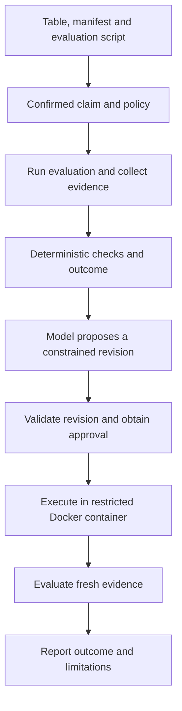

# Understanding ATLAS, end to end

Personal learning guide for Adnan · 15 October 2026 · last checked against the T-02 acceptance commit (the commit after `75a98f4`)

## How to use this guide

This explains the project you are building, starting from basic programming. Read one section, explain it aloud without looking, then inspect one corresponding function locally. You do not need to understand the whole repository in one sitting.

**Evidence boundary:** last checked against the local repository at the T-02 acceptance commit, the commit after `75a98f4` that contains this text (15 October 2026): task statuses against `TASKS.md` and `STATUS.md`, and the paths, names, flags and code excerpts against the source. It is not a line-by-line audit. Local source code, `docs/SPEC.md`, `DECISIONS.md`, `TASKS.md` and `AGENTS.md` remain authoritative; if this guide disagrees with them, they win. This is a learning document, not another agent instruction file or a replacement specification.

**Status words used here** (they are deliberately different):

| Word | Meaning |
| --- | --- |
| Planned | Designed or listed as a task; no code yet |
| Implemented (self-tested) | Code exists and the builder's own tests pass |
| Independently verified | A separate reviewer (Codex) reran the evidence and found no remaining blocker |
| Accepted | The lead accepted the task within its documented scope |

## 1. The problem in one minute

A machine-learning project reports high accuracy. Does that evaluation actually support the intended use?

Imagine a wearable recognizing gestures. If recordings from the same person appear in training and testing, the model may recognize person-specific patterns. Good scores on those recordings do not establish performance on a new person. That connects directly to your experience with sEMG placement and session drift, although ATLAS itself is currently a tabular classification project, not a wearable application.

ATLAS compares an evaluation with a confirmed deployment claim. It checks evidence for specific violations and reports what it could and could not assess.

**Planned complete workflow:** inspect an evaluation, diagnose an evidence-backed problem, propose a constrained code change, obtain approval, run it in a restricted container, and evaluate the new evidence. A model proposes; explicit evaluation rules determine the result.

ATLAS cannot prove that a model is universally valid, that its data represent reality, or that every possible leakage route has been excluded.

**Say it yourself:** “ATLAS checks whether a machine-learning evaluation supports its stated use, and is being built to propose and verify constrained repairs.”

## 2. What exists today

| Component | Status at this checkpoint | What this establishes |
| --- | --- | --- |
| Requirements and evaluation policy | Recorded; policy-v1.3 (T-02 contract decided by the lead on 15 October 2026) | Explicit rules and supported scope |
| T-01 deterministic audit | Accepted at `f5aa4dc`, after Codex's independent verification (165 tests passed) | Specified behavior on trusted synthetic fixtures and review cases |
| T-04 model connection | Accepted within its smoke-test scope | Real NVIDIA text response and strict application-validated JSON response |
| T-05 restricted runner | **Accepted at `eed73ee`** within its documented scope, after two repairs and Codex's independent verification of each. The documented limitations stand (section 7) | The runner's isolation contract on this host (28/28 contract tests with Docker required). It runs an approved candidate; it does not judge the result |
| Candidate re-evaluation integration | **T-06 slice 1 implemented; Codex's review found three P2 defects; Codex verified the repairs (repair pass 2 at `1d58b20`, no remaining blocker), so slice 1 is independently verified within its documented scope; T-06 is not accepted.** An approved candidate runs in Docker, and the trusted evaluator re-evaluates the full required set from a *candidate view* whose trust is anchored outside the candidate's outputs (section 7). No model is involved yet | The builder's offline tests and four real Docker runs on `benchmarks/t01/s01_faulty`. Not independently verified |
| Bounded agent controller (fixture replies) | **T-06 slice 2 implemented; Codex's review found four P2 defects; its verification of repair pass 1 found two more gaps; Codex's verification of repair pass 2 found one more finalization gap; repair pass 3 left one more gap (a first report-write failure); Codex verified repair pass 4 at `69042a1`, so slice 2 is independently verified within its documented scope; not accepted.** Strict one-action replies, 6 attempts including retries, an approval boundary, an in-process network guard for fixture runs (not a sandbox), every run labelled non-live | Offline tests and one real Docker run. No real model has been called by it |
| Docker baseline, CLI approval, production model client | **T-06 slice 3: Codex's review found three P2 defects (invalid usage, partial-usage accounting, configuration validation) and two P3 issues (report prose, an overstated token bound); Codex's verification of repair pass 1 found three remaining P2 defects (invalid usage on a transient error, an echoed model ID in the log, Decimal rounding and overflow in the accounting); Codex verified repair pass 2 at `5e63fc4` with no remaining blocker (370 unit tests passed, 1 skipped; 10 Docker integration tests passed), so slice 3 is independently verified within its documented offline scope; T-06 is not accepted.** The original runs in Docker after a typed approval, like candidates; `--mode agent` with fixture replies; the Nebius client is tested only against a mocked transport | No real model request has been made by it. A live run (slice 4) needs separate authorization and two open ceiling decisions |
| Spending controls, prompt budget, live entry point (slice 4) | **Controls verified by Codex (Gate 1 PASS at `8c79e5a`). The lead's values are decided (Gate 2). The live entry point and pre-run model check are implemented and self-tested offline, awaiting Codex's Gate 3 review. No pre-run call or live run has been made or authorized.** A live run needs `--live`, `ATLAS_MODEL_MODE=live` and the exact authorized amount. It refuses before touching anything otherwise, and aborts if the provider's listing differs from the configuration | Mocked-transport tests only. The owner also ran the NON-LIVE fixture CLI demonstration once on s01 (REPORT; four FAILs became PASS) |
| T-02 time, window and metric checks | Implemented at `487664e`. Codex verified the repairs of its first review's four defects (`0cf955d`) and of a split-evidence decoding defect (`bb9bac8`). Codex then verified the provenance and run-index decoding repairs (pass 3), and the structural checks of that evidence (passes 4 and 5). **Accepted by the lead at `75a98f4`** within its documented trusted-fixture scope. The limitations stand | The builder's tests pass on trusted synthetic fixtures. Not independently verified yet |
| T-03 hosting and isolated-worker probe | **Accepted by the lead at `51d3dd8`** within its research-and-feasibility scope (16 October 2026). It chose limited hosted mode for V1 (curated examples and trusted evaluation functions; generated diffs are shown as "not executed here"), with full Docker execution in the local build. It also selected Neon Postgres as the future budget store | A recommendation with dated sources, and small owner-run probes: a minimal Streamlit build, a secret canary, one sleep/wake cycle, and the budget-store scenarios on Neon. It does **not** establish production readiness, guaranteed availability, promotional-credit eligibility or isolation on any remote worker. The budget caps are planned, not built, so they are not a spending ceiling |
| Memory comparison, real-data study, UI and hosted demo | Planned. The hosted demo must still test Nebius connectivity and the full locked build on the host before it can be called ready (T-12) | Do not describe these as shipped |

The initial runtime model is `nvidia/nemotron-3-super-120b-a12b` served through Nebius Token Factory. Claude and Codex help develop ATLAS; they are distinct from the NVIDIA model that ATLAS will call at runtime.

## 3. Follow the data through the intended system



This diagram describes the target workflow. Today the trusted fixture audit, model smoke calls, and restricted runner are separate pieces; the integrated revision workflow is not complete.

| Item | Meaning |
| --- | --- |
| Table | Rows of observations, features, target labels and identifiers |
| Manifest | Declares what columns mean and how evaluation should be interpreted |
| `evaluate.py` | The project's evaluation code: splits, preprocessing, fitting and predicting |
| Adapter | Small API through which project code declares splits and writes predictions |
| Recorder | Captures supported fit/use operations and their observed ancestry |
| Evidence | Files describing what happened, including identifiers, predictions and execution records |
| Evaluator | Checks that evidence against explicit rules |
| Candidate | A proposed replacement of the permitted evaluation code |

An important distinction: candidate-produced evidence is untrusted input. Read-only recorder files do not make an in-process recorder tamper-proof.

## 4. The machine-learning ideas you need

### Training, evaluation and claims

Training is when the model learns parameters. Evaluation measures predictions on selected rows. A deployment claim describes where you want those results to apply.

The three supported claim types are:

- `same_population`: the declared population and dependence assumptions must justify the assessment. This does not make every random split acceptable.
- `unseen_group`: the evaluation must respect separation of the relevant groups, such as people absent from training.
- `future_time`: evaluation must respect temporal order and when information would actually be available.

Combined group-and-time claims are outside the selected V1 scope.

In code, `src/atlas/policy.py` lists these three in `SUPPORTED_CLAIM_TYPES` (policy-v1.3). "Supported" means in scope, not fully checked. The accepted T-01 slice covers `unseen_group` fixtures. T-02 adds the time, window and metric checks that `future_time` and `same_population` need; it is implemented. Every defect found by its reviews is repaired and independently verified, and the lead accepted T-02 at `75a98f4` within its documented scope: trusted synthetic fixtures, the declared clock, cutoff and containment rules, the supported provenance path, and the metric contracts. Under the older policy-v1.2 those checks were recorded as `NOT_ASSESSED` (`unimplemented_assertion`), never PASS.

### Leakage and preprocessing

A scaler learns means and variances. A feature selector may learn which inputs best predict the label. These are learned operations even though they happen before the classifier.

If preprocessing learns from test rows, information has crossed the evaluation boundary. A model can inherit that contamination from an earlier operation.

### Tiny Python example: a group-overlap check

```python
train_subjects = {"S01", "S02"}
eval_subjects = {"S02", "S03"}
overlap = train_subjects & eval_subjects

if overlap:
    print("Known overlap:", overlap)
```

The intersection contains `S02`. This is a set operation, not an AI judgment. The applicable claim determines what the overlap means.

This example deliberately omits production validation. What if the subject column is missing? What if identifiers are null? What if the split file is corrupted? Those cases require different results; they cannot all become an empty set and PASS.

### Fold and provenance

A fold is one declared training/evaluation split. The same row may play different roles in different folds. Fit provenance asks which rows contributed to learned state and where that state was later used.

Judge a fitted state against the training rows of the fold where it is used. A state fitted earlier is not automatically safe or unsafe: the contributing rows and current use matter.

Exercise: a scaler learns from rows `{1, 2, 3}`. It is used in a fold with training rows `{1, 2}` and evaluation row `{3}`. Why is that a violation? Answer: row 3 influenced the scaler while being held out for this use.

### Time, windows and honest metrics (T-02: accepted within its documented scope)

T-02 adds checks for evaluations where time matters. The rules were decided by the lead on 15 October 2026 (`DECISIONS.md`, "T-02 contract dispositions"). Codex's reviews found several defects (below). All are repaired and independently verified, and the lead accepted T-02 at `75a98f4`. Accepted means the listed checks behave as specified on trusted synthetic fixtures. It does not mean the evaluation of a real project is proven sound, or that the checks establish statistical independence.

**A label you could not have known yet.** A row predicted on day 100 has an outcome that becomes known on day 150. If a model trained with a cutoff of day 120 used that label, it learned something it could not have known on day 120. ATLAS checks both sides of the cutoff:

| Cutoff | Labels known by the cutoff? | Cutoff before the first evaluation day (120)? |
| --- | --- | --- |
| 120 | No (150 > 120): FAIL | Yes: PASS |
| 150 | Yes: PASS | No (150 > 120): FAIL |
| none | Unknown: NOT_ASSESSED | Unknown: NOT_ASSESSED |

No cutoff passes both, which is the point: this evaluation cannot honestly support a "works on future days" claim. Fixture `benchmarks/t02/s11a_future_time_label_leak` shows the same leak in a real run.

**Half-open windows.** A window `[0, 10)` contains 0 to 9.999… but not 10. Two windows overlap only if they share a positive span:

```python
def overlaps(a, b):
    return max(a[0], b[0]) < min(a[1], b[1])


print(overlaps((0, 10), (10, 20)))  # False: they only touch
print(overlaps((0, 10), (5, 15)))  # True: they share [5, 10)
```

C++ connection: this is the same convention as `begin()`/`end()` iterators, where `end` is one past the last element. ATLAS also refuses to use a window whose start is not before its end. Such a window is unusable metadata, not evidence that the check passed.

**One clock or many?** The manifest declares whether all times share one clock (`global`) or each stream has its own (`per_stream`). One row's feature time against that same row's prediction time is a comparison on one clock, so it can be checked either way. A single cutoff compared with every row needs one shared clock. ATLAS never guesses which applies from free text.

**Documented is not verified.** If a dataset has no stream column, a project may declare in writing that each recording stays within one person. ATLAS records that declaration prominently and relies on it only together with a valid "no person in both partitions" result. It never claims to have verified the declaration, and it never fetches the cited source. A declaration the table visibly contradicts is not used at all.

**Averages that hide a missing fold.** Suppose four folds were declared but one has no valid predictions. Averaging the three remaining folds would quietly report a different experiment. ATLAS is designed to mark such an aggregate incomplete and refuse to PASS it, while still showing each valid fold's value.

The first version did not fully live up to that: two folds declared with the *same name* let the later fold's result overwrite the earlier fold's error, so an incomplete aggregate was reported as complete. The repair, now independently verified, treats a repeated fold name as ambiguous evidence, so both folds become evidence errors.

**Floating-point at the edge.** The reported-metric rule is `abs(reported - recomputed) <= 1e-6`, applied literally to binary floats. Many decimals have no exact binary form, so a difference meant to be exactly 1e-6 can land just above it:

```python
print(abs((5 / 9 + 1e-6) - 5 / 9))  # 1.0000000000287557e-06, which fails
```

C++ connection: `double` behaves the same way, because it is the same IEEE 754 format.

**What the first review found.** Each of the four defects is a general programming lesson:

- **"Both must hold" can fail on partial information.** The training-label rule needs the prediction time *and* the label time to be at or before the cutoff. If the prediction time is already after the cutoff, the rule is broken even if the label time is unknown. The first version gave up when either value was missing. Now each known value is compared on its own, and missing values only prevent a PASS.
- **One column, two roles.** A table may use the same column as both stream and group. Selecting it twice created a table with two columns of the same name, and pandas refused to group it. Now each role is selected separately.
- **Numbers too big for a float.** Python integers have no size limit, but a float stops near 1.8 × 10^308. `float(10**400)` raises `OverflowError` instead of returning infinity. Inputs that large are now rejected or treated as invalid evidence instead of crashing.
  - The same idea has a second layer. Python refuses to turn a string of more than 4,300 digits into an `int` at all, which guards against slow conversions. Codex's verification found that a 5,000-digit number inside the run's `splits.json` stopped the evaluator before it could write any result. The fix, now independently verified, treats undecodable split evidence as invalid evidence: every assertion that depends on it becomes ERROR, and the outcome is written as INCONCLUSIVE. The digit limit itself is left unchanged.
  - Decoding is only half the job: text can be perfectly valid JSON and still have the wrong *shape*, such as a list where an object belongs or a word where a number belongs. ATLAS now checks the split declarations, each provenance event and the run index before any check reads them. It looks at the fields the evaluator's checks actually read, with the types the recorder and adapter write. Split row IDs must also exist in the table and not repeat within a list, as the adapter guarantees when it records them. A wrong shape is treated exactly like undecodable text. This is a check of those fields, not a complete validation of every possible file content. A first version missed one fit-event field and the split entries entirely, which shows why the field list has to be derived from the code that reads it.
  - The same applies to the provenance log and the run index (independently verified). One bad line makes the *whole* provenance log invalid: ATLAS never trusts the lines that happened to decode before it. Only the fit checks that need provenance become ERROR, so a timing violation shown by the separate split and table evidence still stands. A run index that cannot be read leads to a fresh INCONCLUSIVE result rather than leaving the previous run's outcome in place.
- **A name used as a key must be unique.** A Python dictionary keeps only the last value for a repeated key:

```python
scores = {}
for fold, score in [("f", "error"), ("f", 0.9)]:
    scores[fold] = score
print(scores)  # {'f': 0.9}: the error disappeared
```

C++ connection: `std::map::operator[]` overwrites in the same way, while `insert` keeps the first value. Neither tells you a key was repeated unless you check.

**What these checks do not prove.** Window-overlap and separation checks test declared rules. They are not proof that rows are statistically independent.

Exercise: two windows from the same stream, `[0, 10)` for training and `[12, 22)` for evaluation, and a declared minimum separation of 5. Do they overlap? Do they meet the separation rule? Answer: no overlap. The gap is 12 − 10 = 2, which is less than 5, so the separation rule FAILs.

## 5. Why ATLAS needs more than true and false

| Check result | Meaning |
| --- | --- |
| PASS | The assertion was assessed and satisfied within its recorded coverage |
| FAIL | Valid evidence demonstrates a violation of the assertion |
| NOT_ASSESSED | Applicable assessment could not be completed, for example missing metadata or an unimplemented check |
| ERROR | Required evidence or execution failed in a way that prevents a valid assessment |

Applicability is separate: a check not relevant to a claim is different from a relevant check whose metadata are missing.

Run-level outcomes summarize required applicable checks:

1. Outside supported scope: `NOT_SUPPORTED`.
2. An independently supported required FAIL: `VIOLATION_FOUND`.
3. No valid FAIL, but required gaps or errors: `INCONCLUSIVE`.
4. Every applicable required assertion validly passes: `NO_VIOLATION_FOUND`.

An integrity failure must invalidate the findings that depend on that evidence. A violation established by other valid evidence can still stand.

**Why not “VALID”?** Passing a bounded set of checks is not proof of general scientific validity.

**Why check empty evaluation folds?** No test rows can mean no observed overlap, but also no meaningful evaluation. Policy-v1.2 requires `split.evaluation_folds_nonempty`; an empty evaluation fold prevents a clean headline.

## 6. What the model contributes

The intended model contribution is interpreting the user's claim, explaining findings, and proposing an evaluation-code revision. Deterministic code handles the specified assertions and outcome rules.

**Implemented in T-06 slice 2 (independently verified within its documented scope), with fixture replies only:** the model receives only the permitted context (the claim, the required assertions' statuses, the allowed actions and earlier tool results, file contents marked untrusted), never the API key or hidden answer keys. A production client exists since slice 3, but it has only been exercised against a fake HTTP transport and has never sent a real request.

**How one model reply becomes (at most) one action.** The controller in `src/atlas/agent/controller.py` treats every reply as untrusted text:

```python
action = parse_reply(reply.content).action  # the whole reply, or ReplyRejected
```

`parse_reply` accepts exactly one JSON object such as `{"action": {"tool": "inspect_evidence", "check": "split_integrity"}}`. Prose around it, a Markdown fence, a second action, an extra field such as `"approved": true`, or a repeated key all raise `ReplyRejected`. The run then ends as `ERROR` with nothing done, and the deterministic audit (which ran first) is still in the report. Exercise: why reject duplicate keys, when `json.loads` would simply keep the last one? (Hint: what if the first `tool` were `finish` and the second `propose_patch`?)

**Four lessons from Codex's review of slice 2.** Each is a gap between what a check *says* and what it *measures*:

- A limit named in bytes was checked in characters. `"é" * 40_000` is 40,000 characters but 80,000 UTF-8 bytes (`len("é".encode("utf-8")) == 2`), so it passed a 65,536 limit. The schema now measures `len(diff.encode("utf-8"))`.
- A "no network" guard patched `connect` but not `sendto`. UDP needs no connection, so one datagram reached a local receiver. The guard now covers sending and every resolver, and it is described as what it is: an in-process test safeguard, not a sandbox.
- The time limit was checked before tool actions, but `finish` skipped that path. Checking once, right after every reply returns, covers every action.
- An error with no handler left no report. Now the report is written first; an unexpected exception is then re-raised, because a crash must never look like a successful run. The first repair still had one hole, which Codex found: a failure *while building the report* was caught and the run still said `REPORT`. Error handling has to cover the error handler too. The fallback now writes a minimal report from facts the run already holds, without calling the failed builder again, and still re-raises. Even that was not the end: *logging* the final state could fail too, and that second error replaced the first. The rule that finally holds: keep the first exception before doing anything else, try each cleanup step once, write down later failures (by type, not message) instead of letting them win, and re-raise the first one. The last gap was the plainest case: when *writing the report* was the only failure, the exception propagated but the run's own record still said `REPORT`. Raising an error and recording it are two separate duties. In Python terms, catch into a variable, never let a `finally`-style step raise over it, and attach notes (`exc.add_note(...)`) rather than replacing it. A similar lesson from the diff parser: a rule applied to three of four fields (the hunk's new-start number was skipped) is not the rule. Test every position, not just the one in the bug report.

**Counting attempts, not calls.** Six attempts per run, retries included. If attempts 1-5 succeed and attempt 6 times out, no seventh attempt may be sent to retry it, so the run ends `BUDGET_EXHAUSTED`. The attempt is reserved *before* the request is sent, because a request that times out may still have been processed (and billed) by the provider.

**Who approves?** Not the model. A proposed diff is shown to an `Approver` object, a stand-in for the human; the candidate runs only with an approval bound to its exact hash. Without an approver the run stops at `NEEDS_INPUT`. Time spent waiting for the human is excluded from the 5-minute budget.

**Slice 3: approval at the terminal, and Docker for the original too (independently verified within its offline scope at `5e63fc4`).** `python -m atlas.cli audit benchmarks/t01/s01_faulty --mode agent --fixture-script script.json` first asks before running even the *unmodified* original: the original is code too, so it runs only in Docker, after you type the first 12 characters of its hash. Then the same for each candidate. A subtle point: the diff on screen is written by the model, and a terminal obeys control characters, so a diff containing `"\x1b[2J"` (clear screen) or a carriage return could hide what you are approving. `approval.inert()` prints every such character as a visible escape instead:

```python
from atlas.agent.approval import inert

print(inert("ok\x1b[2J\rAPPROVED"))  # ok\x1b[2J\x0dAPPROVED
```

**Counting money when the answer never arrived.** If a request times out, the provider may still have processed (and billed) it. `budget.CostLedger` therefore reserves the request's *ceiling cost* (both token ceilings at listed prices) before sending it, and keeps it whenever the real usage is unknown. That is why two timeouts in a row show twice the per-request ceiling, even though no reply came back.

Codex's review of slice 3 and its verification of the first repair found these ways it went wrong. All are now repaired, and Codex verified the repairs at `5e63fc4`:

- **A reply's numbers are untrusted input.** The SDK's response objects are not validated at runtime, so `prompt_tokens` could arrive as `-1000`, `9000.5`, `true` or even a string echoing the key. The client and the controller now pass usage through `client.sanitize_usage` first: only a genuine non-negative `int` counts (in Python `True` is an `int`, so the check is `type(value) is int`). Anything else ends the run as `invalid_usage`, no action runs, and the log records only the field's name. That includes usage attached to an *error*: the first repair still retried a transient error carrying invalid usage, so the run went on and acted. Now the check comes before the retry decision.
- **Half an answer is still information.** If the reply says 1,000,000 input tokens but gives no output count, the known input cost ($0.30 at the test prices) is kept even though it exceeds the whole reservation, and only the missing output count is held at its ceiling. A small known count never lowers the original reservation.
- **Configuration values are checked too.** An infinite timeout, a negative or `NaN` price, or `True` as a timeout used to be accepted; `NebiusConfig` now rejects them before any SDK object exists.
- **Echoed text is not safe just because it looks plain.** A reply's model ID was copied into the log even when the reply was rejected for having the wrong one, so a provider echoing a secret could put it there. Now the log records only the configured model ID and whether the reply matched. Request IDs and the served model are logged only if the production client checked them against its key (the controller never sees the key), and error codes only in fixed shapes.
- **`Decimal` arithmetic depends on a hidden setting.** Python's `decimal` module rounds every result to the *current context's* precision (28 digits by default), and anyone can change that context. With 10**40 known input tokens, `(known + held) - known` rounded the $0.0072 output hold to 0. With overflow traps turned off, a huge price became `Infinity`. Now every money calculation runs in a private exact context (`agent/money.py`, 400 digits, with rounding and overflow trapped), within an explicit supported range (counts up to 10**100, prices up to 10**100 USD per token with at most 30 decimal places, timeout at most a day). The hold is computed directly instead of by subtraction. An amount that still could not be represented is marked `unrepresentable` and ends the run; it is never reported as `Infinity`.

**Two kinds of spending limit (slice 4; values decided by the lead at Gate 2).** A limit is only as strong as whatever enforces it, so ATLAS keeps two:

- **The estimate cap ($0.0648).** ATLAS refuses to send a request if what is already committed, plus the next request's ceiling, could pass it. It is enforced by ATLAS, but it counts *estimates*.
- **The authorized maximum ($0.51, for one live run).** Before anything runs, ATLAS works out the worst a run could cost if its input estimate were completely wrong, relying only on the provider's documented limits: 6 requests × (254,144 input + 8,000 output tokens) = $0.5007. It refuses to start if that exceeds the authorization. The figure rests on the provider enforcing those limits, which ATLAS has not verified.

**Refuse early, check the price list, then spend (Gate 3 implementation, not yet run).** The live command is `python -m atlas.cli audit benchmarks/t01/s01_faulty --mode agent --live --authorize-spend-usd 0.51`. Before it touches anything it checks, in order:
1. the flags make sense;
2. `ATLAS_MODEL_MODE` is `live`;
3. the typed amount equals the decided $0.51 (compared as a `Decimal`, so `0.510` is equal but `0.50` is not);
4. the limits cover the worst case.

Any failure exits 2 with no folder created and no key read. Only then does it read the key and make one free `GET /models` to confirm that the model, its two prices and its context length are exactly as configured. A price change aborts with exit 6 before any paid request. The pattern is to make the cheap, reversible checks first, and to treat "I couldn't check" (a timeout, a garbled reply) as "stop", never as "probably fine".

One limit remains and is stated, not hidden: the input ceiling is enforced before sending only by an **estimate** (UTF-8 bytes plus a per-message allowance) that rests on unverified tokenizer assumptions. So the held amounts are estimates, not a guaranteed maximum charge, and the lead accepted the 12,000-token figure as an estimate, not a guarantee. The production client (`agent/nebius.py`) and the pre-run check have only been exercised against a fake HTTP transport.

**Accepted in T-05:** `validate_diff` in `src/atlas/candidates.py` accepts a proposal only as a unified diff of the one permitted entry-point file. A diff that touches the manifest, the table, the evaluator or a second file is rejected, so a proposal cannot change the evaluator to award itself a pass.

The two completed Nebius tests establish that authentication works and this model can return a short response and a valid JSON object. They do not establish reliable diagnosis, tool use or repair.

### JSON and Pydantic

JSON is a text format for structured values:

```json
{"project":"ATLAS","status":"ok"}
```

Pydantic validates the structure and allowed values in Python. It can reject missing fields, unexpected fields or invalid types, according to the schema. It does not prove the factual correctness of a diagnosis.

The selected starting approach asks for JSON in the prompt and validates the entire reply in the application. It is not verified provider-enforced structured output. Malformed or incomplete output must not authorize actions.

### API spending

For the recorded rates, a response with 47 prompt tokens and 52 completion tokens costs:

`47 × $0.30 / 1,000,000 + 52 × $0.90 / 1,000,000 = $0.0000609`

The response reported reasoning tokens inside completion tokens; adding them again would double-count them. These rates are a historical checkpoint, not a permanent price promise. Token caps limit a request; application call budgets limit an execution path; neither guarantees an account-wide spending cap.

## 7. Why Docker matters—and what it does not prove

Generated Python can do more than train a model. It can read files, open connections, create processes or allocate memory. The runner limits these capabilities before executing candidate code.

| Restriction | Purpose |
| --- | --- |
| No network | Candidate cannot make ordinary external network calls |
| Restricted read-only inputs | Candidate cannot edit the original project or evaluator |
| Explicit environment | Host secrets are not inherited into candidate execution |
| Non-root, dropped capabilities, Docker's default seccomp profile | Reduce available operating-system privileges |
| Memory, CPU and process limits | Bound resource use |
| External deadline, removal and confirmation | Stop a run that takes too long, try to remove its container, and report honestly whether removal was confirmed |
| Bounded output collection | Treat returned files as untrusted input to the host |
| No host fallback | Missing isolation means no candidate execution |

These restrictions are part of T-05, accepted at `eed73ee` on the evidence of its contract tests on this Windows/Docker Desktop host (not on other hosts). In code they are command-line flags built by `docker_run_args` in `src/atlas/runner/docker.py`, for example:

```python
args = [
    ...
    "--network", "none",  # no network interfaces except loopback
    "--read-only",  # root filesystem cannot be written
    "--cap-drop", "ALL",  # no Linux capabilities
    "--pids-limit", str(limits.pids),
    ...
]  # fmt: skip
```

Each flag is one string in a Python list that is passed to the Docker CLI. (`# fmt: skip` tells the formatter to keep each flag next to its value, as the real code does.) Exercise: which contract test would fail if `"--network", "none"` were deleted? (Hint: search `tests/integration/test_runner_contract.py` for "network".)

Cleanup has a limit too. The runner can ask Docker to remove a container, then ask Docker whether it is gone. If the Docker API is unreachable or fails, neither answer is available, so the runner records cleanup as `unknown` and reports the run as `cleanup_failed`; it never reports success. That is fail-closed reporting: it does not, and cannot, guarantee that the container was physically removed.

Docker is a risk-reduction boundary, not a claim that all hostile code is safe. It also cannot make candidate-produced scientific evidence true.

A hash identifies bytes. It helps bind approval to the exact candidate and detect changes. It does not prove those bytes are honest or scientifically correct. Approval currently exists as a programmatic operation; the user-facing approval flow is pending.

The trusted fixture runner is an explicit separate path for reviewed, allowlisted fixtures. Its existence must never become a fallback that runs an arbitrary candidate on the host.

### What T-05 acceptance covers, and what waits for T-06

**Accepted (T-05, `eed73ee`):** the runner can take an approved candidate, run it in the restricted container, collect its outputs as untrusted input, and always save a final status. The contract tests showed the restrictions above on this host.

**Implemented in T-06 slice 1 (self-tested, awaiting review, not accepted):** connecting the runner to the evaluator. "The runner works" and "ATLAS re-evaluates candidates" are different claims; only the first is accepted. The next subsection explains the second.

### T-06 slice 1: how ATLAS decides to trust a container's evidence

The container returns files the candidate wrote: `splits.json`, `provenance.jsonl`, predictions and `runtime.json`. The candidate is the code under review, so those files cannot vouch for themselves. The host also writes its own record, `execution.json`. Even that record cannot be checked only against itself.

**A circular check, and why it fails.** Suppose the evaluator rebuilt the expected `docker run` command from the limits written in `execution.json`, then compared it with the command written in the same file. Someone who raised the memory limit *and* edited the recorded command to match would pass: both sides of the comparison come from the same place. `src/atlas/docker_evidence.py` instead rebuilds the command from values it does not take from that record:

```python
expected_args = dr.docker_run_args(
    record.container_name,
    EXEC_DIR,  # the view's own layout
    (stage / "project").resolve(),
    (stage / "code").resolve(),
    docker.image_id,  # confirmed separately by asking Docker
    TRUSTED_LIMITS,  # the runner's fixed limits, not record.limits
)
```

The test `test_tampered_execution_record_is_not_trusted[limit_and_command_changed_together]` changes both the limit and the command and expects refusal. A deliberately weakened copy that takes the limits from the record is caught by exactly that test.

**Other anchors outside the record:** the approval file written *before* execution; the snapshot, re-hashed from disk; the staged files, re-hashed (the mounted adapter and recorder must equal the evaluator's own copies); and the image, which Docker itself must confirm is the runner image.

**Host-owned names.** The candidate's files are copied into the view only through an explicit list (`map_collected`). A file named `execution.json`, `INDEX.json` (any capitalization) or `outcome.json` collides with a host record and makes the evidence untrusted. Each view file is opened with mode `"xb"`, which refuses to replace an existing file.

**Execution status is not the scientific outcome.** These are separate fields in the report:

| Candidate (on `s01_faulty`) | Execution status | Scientific outcome |
| --- | --- | --- |
| Fold-local selection and grouped folds | `completed` | `NO_VIOLATION_FOUND` |
| A harmless comment | `completed` | `VIOLATION_FOUND` (it ran fine; the flaw remains) |
| Raises before any evidence | `failed` | `INCONCLUSIVE` (missing evidence stays ERROR) |
| Raises after writing the faulty evidence | `failed` | `VIOLATION_FOUND` (a later crash does not erase a supported violation) |

If the *shared* record or its binding fails (the approval, the snapshot, the staged bytes, the configuration), every PASS *and* FAIL becomes ERROR, because nothing from that execution can be attributed to the approved candidate. A single collected file is different (repair pass 1, after Codex's review): if `provenance.jsonl` is missing or no longer matches the hash the host recorded when it collected it, only the assertions that read provenance lose their evidence. The group-overlap FAILs, which come from the separately verified split and table evidence, stand. Before the repair, one lost file erased every finding, so the result depended on *when* an unrelated file disappeared. Likewise, a prediction file whose hash matches but which is not readable Parquet, or lacks `row_id`/`y_pred`, is recorded as an evidence error for its dependants instead of crashing the evaluator before any report is written.

**Whose rules apply when nothing runs?** Even a refused candidate's report lists the required assertions, so it matters *which* manifest supplies them. Codex found (repair pass 2) that approval for snapshot A combined with a different, valid snapshot B produced a refusal listing **B's** ten assertions instead of A's nine. Nothing ran and nothing passed, but the report described the wrong contract. The fix checks, before anything is derived, that the supplied snapshot is the approved one (`approval.base_snapshot_hash == snapshot.base_hash`). If it is not, the report says the approved set cannot be reconstructed and lists none. An honest "unknown" is better than a plausible but wrong list.

**What this does not prove.** Matching hashes show consistency, not authenticity against someone who controls the host. The container's files are still written by the candidate's process (`runtime.json` only corroborates). In slice 1 the original is audited by the trusted host-fixture runner while candidates run in Docker, and the report says so; final acceptance needs Docker for both.

**Limitations that acceptance did not remove** (details in `TASKS.md`, T-05 "ACCEPTANCE"):

- **Stable, trusted host directories:** the file checks would not notice a directory swapped partway along a path.
- **Narrow archive format:** only the layout the container's supervisor writes is accepted. The cross-check assumes this Python version's `tarfile` (3.11.17).
- **Programmatic approval:** approval is a function call (`approve()`); there is no approval screen yet.
- **Candidate-produced provenance:** the recorder runs inside the candidate's own process, so its evidence comes from the code being checked.
- **Unknown physical cleanup:** if the Docker API fails, the run is reported `cleanup_failed`. ATLAS cannot confirm the container is gone.
- **Windows path length:** see below.

**A real example: Windows path length.** During verification, Codex ran the unit tests from a deep folder. One test writes a valid file named `d/` followed by 150 `n` characters and `.txt`. Its full path came to 260 characters, and Windows refused to create it (`FileNotFoundError`); this host allows 259 characters in an ordinary path. With a shorter temporary folder the same path was 253 characters, and every test passed. You can check the arithmetic yourself:

```python
import os

folder = r"C:\Users\Lain\source\atlas\runs\review-t05\repair2-eed73ee\unit-tmp\test_prechecked_layout_matches0\out\d"
print(len(os.path.join(folder, "n" * 150 + ".txt")))  # 260
```

The archive checks limit what the archive *contains*; they cannot know how deep the destination folder on the host will be. In a real run this failure is recorded as `collection_failed` (`write_failed`), not as success. It is a documented limitation rather than a fix: the fix would use Windows extended-length paths when writing outputs. C++ connection: a fixed-size buffer such as `char path[260]` fails in exactly this way.

## 8. Learn debugging from the three T-05 review findings

Codex review 1 (of `f494c95`) found three P2 defects, and repair commit `2e58280` addressed them. Codex then checked that repair (at `44c5a84`):

- **A and B are independently verified as fixed.**
- **C was only partly fixed.** Codex found two inputs that still got past the structural limits. Repair pass 2 (`eed73ee`) addressed them, and its new regression tests failed before the repair and passed after it.

Codex then verified repair pass 2 independently: both parser defects were fixed, and no remaining blocker was found. The lead accepted T-05 at `eed73ee` within its documented scope. Details: `TASKS.md`, T-05 "REVIEW 1 … REPAIR PASS 1", "CODEX VERIFICATION OF REPAIR PASS 1 … REPAIR PASS 2", "CODEX VERIFICATION OF REPAIR PASS 2" and "ACCEPTANCE".

### A. Unknown cleanup is not successful cleanup

If Docker cannot be contacted, the runner does not know whether a container remains. The defect treated inspection failure as confirmed absence. Another path allowed a completed status despite removal being unconfirmed.

The lesson is three-valued reasoning: present, absent and unknown are distinct. Catching an exception and returning a reassuring value can corrupt the meaning of a program.

The repair in `src/atlas/runner/docker.py` makes the three values explicit. `_container_listed` returns `True`, `False`, or `None` when Docker could not answer:

```python
if proc.returncode != 0:
    return None, f"listing failed: {_cli_error(proc)}"  # unknown, NOT absent
return name in proc.stdout.decode("utf-8", "replace").split(), None
```

`_remove_container` turns that into `cleanup` = `confirmed_absent`, `still_present` or `unknown`, and `_finish` refuses to report a plain outcome when removal is unconfirmed: the run's status becomes `cleanup_failed`, and the outcome it replaced is kept in `execution_status`. Note the Python detail `record.get("container_removed") is False`: it is true only for the value `False`, not for a missing key (`None`).

This makes the *report* honest; it does not make removal certain. When the Docker API fails, nobody on the host can confirm the container is gone, so the runner reports `unknown` and fails closed rather than guessing.

Regression test to read: `test_daemon_failure_does_not_confirm_removal` in `tests/unit/test_runner_lifecycle.py`. It runs offline with a fake Docker CLI.

### B. A limit checked too late is not protection

```python
# Too late: the allocation already happened.
data = file.read()
if len(data) > limit:
    raise ValueError("too large")
```

A bounded read requests at most `limit + 1` bytes, then rejects oversize input before parsing. Checking the opened file's metadata also helps, but a prior pathname size check alone does not protect against later changes.

The review demonstrated that oversized entry code reached `ast.parse` before its limit was applied. Parsing itself is work performed by the host, before candidate isolation.

The repair in `src/atlas/candidates.py` validates the path, opens the file once, checks that the opened file is the same regular file that was checked by path (same device and inode, within the size cap), and only then reads:

```python
with _open_permitted(root, rel, max_bytes) as f:
    data = f.read(max_bytes + 1)  # never more than the cap plus one byte
if len(data) > max_bytes:
    raise SnapshotError(f"{rel} exceeds {max_bytes} bytes")
```

Why `+ 1`? Reading exactly `max_bytes` cannot tell "exactly at the limit" from "over the limit"; one extra byte can. Revalidation now stops at the first unexpected file and hashes in chunks under the same caps. Regression test to read: `test_oversized_entry_is_refused_before_intake_parsing` in `tests/unit/test_candidates.py`.

### C. Small input can still be deeply nested

A byte limit does not necessarily constrain parser nesting. Deep JSON and chained archive extensions raised `RecursionError` below the existing byte caps. The error escaped, leaving an unfinished execution record.

The repair checks structure with loops before handing input to a recursive parser. `_json_depth_exceeds` counts brackets outside strings, one token at a time, and refuses a header nested deeper than 8 levels before `json.loads` runs:

```python
for token in _JSON_TOKENS.finditer(text):
    t = token.group()
    if t in ("[", "{"):
        depth += 1
        if depth > max_depth:
            return True
    elif t in ("]", "}"):
        depth -= 1
```

A loop uses constant stack space however deep the input is; a recursive parser uses one stack frame per level. (C++ connection: the same reason a deep recursive function can overflow the call stack.) `_check_tar_structure` similarly walks the raw tar headers in a loop and allows at most one PAX extension header per file. Any failure during collection is saved as `collection_failed`, and any other unexpected error as `runner_error`, after cleanup has run. Regression tests to read: `test_deeply_nested_header_is_a_collection_error` (`tests/unit/test_runner_collection.py`) and `test_nested_header_is_a_recorded_collection_failure` (`tests/unit/test_runner_lifecycle.py`).

**What the first repair got wrong.** The checks above were real, but they could be bypassed, because each check read the input differently from the parser after it (section D). After repair pass 2, which Codex verified independently and which is part of the accepted T-05, the structural limits are:

- **Header:** decoded once as strict UTF-8 (no byte-order mark, no NUL bytes). The depth limit (8) and `json.loads` both read that same text.
- **Archive:** only the layout the supervisor writes. That means ordinary files, each preceded by at most one PAX extension header holding only a UTF-8 `path` record, with zero bytes in that header's padding. It also means valid checksums and numeric fields, and nothing after the end marker.
- **Cross-check:** `tarfile` is then stepped one member at a time and must report exactly the layout the pre-check read. It therefore never starts reading at a header the pre-check did not accept.

Neither limit is a byte-count limit: both bound how the input is *interpreted*. Regression tests to read: `test_non_utf8_header_is_refused_before_parsing` and `test_nonzero_pax_padding_is_refused_before_tarfile` (`tests/unit/test_runner_collection.py`).

Known limitations of the repairs are listed in `TASKS.md` and summarized in section 7; for example, the same-file check does not detect a directory swapped partway along the path.

### D. Check and parse the same representation

Both remaining parser bugs had one cause: the safety check and the parser looked at different versions of the same input.

Text is stored as bytes, and the same characters have different bytes in different encodings:

```python
raw = '{"a": [[1]]}'.encode("utf-16-le")
print(raw[:6])  # b'{\x00"\x00a\x00'  -- a zero byte after every ASCII character
json.loads(raw)  # works: given bytes, json detects UTF-16 by itself
```

The old depth check scanned `raw` as if it were one byte per character. Inside UTF-16, an escaped quote (`\"`) fooled its idea of where strings start and end, so it skipped brackets that `json.loads`, decoding UTF-16, really saw. A 20-deep header passed a limit of 8. The fix decodes once, `text = raw.decode("utf-8")`, and gives the same `text` to both the check and the parser.

The archive bug had the same shape. A PAX header declares how many bytes of records it has, and the old check read exactly that many. `tarfile` reads the whole 512-byte block, including the padding after the declared records. A record hidden in the padding, such as `size=0`, was invisible to the check but obeyed by `tarfile`. The fix requires the padding to be zero and then cross-checks `tarfile`'s result against the pre-check.

The rule to remember: **validate the exact object you will use.** If you check one representation and then convert or re-read the input, you have checked something else. C++ connection: it is like checking `s.size()` on one `std::string` and then passing a different buffer to the function that uses it.

These were bounded reproductions. The review did not demonstrate a container escape. Distinguishing a demonstrated defect from a hypothetical larger exploit is part of sound engineering.

## 9. Navigate the repository by purpose

| Read locally | Question to answer |
| --- | --- |
| `PROJECT_BRIEF.md`, `docs/PRD.md` | Who needs this and what should the product do? |
| `docs/SPEC.md`, `DECISIONS.md` | What exact behavior is required, and why? |
| `TASKS.md`, `STATUS.md` | What is complete, under review or pending? |
| `src/atlas/policy.py` | Which assertions are required for a claim? |
| `src/atlas/checks/split_integrity.py` | How do rows and identifiers become findings? |
| `src/atlas/checks/temporal.py` | How are windows, separation and time availability checked (T-02)? |
| `src/atlas/checks/independent_metrics.py`, `src/atlas/evaluator.py` | How does ATLAS recompute metrics and compare reported ones (T-02)? |
| `GLOSSARY.md` | What do the project's terms mean exactly? |
| `src/atlas/contracts.py` | Which statuses, outcomes and reason codes exist? |
| `src/atlas/intake.py` | When is a project outside the supported scope? |
| `src/atlas/adapter.py`, `src/atlas/recorder.py` | How does project execution produce observed history? |
| `src/atlas/audit.py` | How are evidence and results assembled? |
| `src/atlas/candidates.py` | How are permitted files and approved changes constrained? |
| `src/atlas/runner/trusted.py` | How are reviewed, allowlisted fixtures run (not a sandbox)? |
| `src/atlas/runner/docker.py` | How does the host launch, collect and clean up? |
| `src/atlas/runner/container_entry.py` | What happens inside the container? |
| `src/atlas/docker_evidence.py` | Which container evidence does the evaluator trust, and why (T-06 slice 1)? |
| `src/atlas/agent/execute.py`, `src/atlas/agent/report.py` | How does an approved candidate become a re-evaluated, reported result? |
| `src/atlas/agent/controller.py`, `schemas.py`, `budget.py`, `client.py` | How does a (fixture) model reply become at most one bounded action (T-06 slice 2)? |
| `src/atlas/agent/approval.py`, `src/atlas/agent/nebius.py`, `src/atlas/agent/money.py`, `src/atlas/cli.py` | How are the original and candidates approved at the terminal, and how would a real model request be bounded and accounted exactly (T-06 slice 3)? |
| `scripts/nebius_smoke.py` | How does a bounded model request work? |
| `benchmarks/t01/`, `benchmarks/t02/` | Which small synthetic fixtures demonstrate each rule? |
| `tests/unit/`, `tests/integration/` | What behavior has executable evidence? |

Do not start by reading every line. Trace one input to one output. For each function, identify its inputs, return value, side effects, callers, assumptions and failure cases.

## 10. Your C++ fundamentals are relevant

| Fundamental | Python/ATLAS connection |
| --- | --- |
| Variables and types | Row IDs, configuration values, budgets and status labels |
| Conditions | PASS/FAIL/unknown branches; approval checks |
| Loops | Inspect folds, files and observed fit events |
| Functions | Isolate one check with clear inputs and outputs |
| Collections | Lists of rows, dictionaries of evidence, sets of overlapping IDs |
| Classes and records | Typed manifests, validation schemas and result objects |
| Exceptions | Turn failed operations into explicit, meaningful failure states |
| Files and paths | Restrict snapshots, preserve evidence and reject traversal |
| Resource management | Close files, stop subprocesses and remove containers |
| Algorithms | Avoid repeatedly scanning large inputs or parsing before limits |

C++ and Python differ in details, especially typing and memory management. The skill of tracing state and control flow transfers. Keep learning C++; learn enough Python alongside ATLAS to inspect and modify small parts independently. Do not rewrite this project in C++ merely to match your course.

## 11. An eight-session learning route

Each session can take roughly 15–25 minutes. Move on when you can explain the idea, not when you have memorized a file.

| Session | Read and do | Explain without notes |
| --- | --- | --- |
| 1 | This guide §§1–5; manually compute a set intersection | Why does the deployment claim change whether a split is acceptable? |
| 2 | One split check and its unit test | What makes missing evidence different from a violation? |
| 3 | One clean and one faulty fixture | Where does preprocessing learn, and which rows influenced it? |
| 4 | Policy and one outcome test | Why can a valid FAIL survive an unrelated ERROR? |
| 5 | Smoke script; trace it without executing paid calls | Where do key loading, caps, API response and schema validation happen? |
| 6 | Candidate validation and one rejection test | Why must approval identify exact bytes? |
| 7 | `_remove_container` and `_finish` in `src/atlas/runner/docker.py`; `test_daemon_failure_does_not_confirm_removal` (offline, no Docker needed) | What happens when the daemon becomes unreachable? |
| 8 | T-06 slice 1 (self-tested): trace one candidate from `validate_diff` through `execute_and_reevaluate` to `comparison_report`; the model step is still planned | Who proposes changes, who executes them and who judges the result? |

At each session, first predict behavior. Then inspect code or run the already-approved offline test. Finally explain any mismatch. Save your own explanation in a few sentences; do not merely copy a generated answer.

## 12. A tutoring prompt for the local agent

Use this separately from an implementation task:

```text
Teach me one small part of ATLAS using the current local code. I know basic Python and am learning C++ fundamentals.

Read the relevant function and one test. Do not edit files or run paid calls.
1. Explain the purpose with a concrete input/output example.
2. Show a short excerpt and explain unfamiliar syntax.
3. Ask me one prediction question and wait for my answer.
4. After I answer, explain the result and connect it to the real code.

Separate implemented behavior from plans. Do not quiz me on multiple concepts at once or give the answer before I try.
```

For the first session, add: “Start with a group-overlap check, not the entire runner.”

## 13. Being the engineer of an AI-assisted project

Using an agent does not remove your responsibility for requirements, judgment and verification. Your goal is to become able to recognize when its answer is unsupported, not just to produce longer prompts.

Before a task: describe the intended behavior and a counterexample. Afterward: examine the diff, ask what evidence demonstrates success, and distinguish the builder's claim from independent verification. If a repair changes the meaning of a rule, resolve the policy first instead of allowing tests to redefine it silently.

The T-01 repeated-measures repairs are a useful example: the project had to distinguish a violation supported by the relevant known rows from an unrelated group failure elsewhere. That was a reasoning and specification problem as well as a coding problem.

Behavioral skills can remind agents to make smaller changes and disclose uncertainty. They do not replace understanding the domain, good tests, bounded execution or an independent review.

## 14. Résumé and interview readiness

You can list an AI-assisted project, but describe work and outcomes you can explain. Do not claim future features as completed, a smoke test as model-quality evaluation, or a container as tamper-proof execution.

Current example, qualified to the checkpoint:

> Built an AI-assisted Python prototype for auditing tabular ML evaluations against deployment claims; implemented deterministic checks with 165 independently verified tests and smoke-tested NVIDIA Nemotron access through Nebius Token Factory. Built a restricted Docker runner for candidate code (no network, read-only root, resource limits), independently verified on one Windows host; connecting it to the evaluator is planned.

Use “built” only if you can discuss your role in directing, reviewing and understanding the work. In an interview, describe Claude/Codex assistance candidly when asked; distinguish generated implementation from decisions and verification you owned. Replace the example with measured end-to-end outcomes when those exist. Test count alone is not the project's value.

Practice these questions:

1. What failure does ATLAS catch that ordinary accuracy reporting misses?
2. Which parts need a model, and which are deterministic?
3. Why is NO_VIOLATION_FOUND deliberately weaker than VALID?
4. What does a hash prove, and what does it not prove?
5. What happens if model JSON is malformed?
6. Why is a Docker failure never permission to run a candidate on the host?
7. Explain one bug, its counterexample, the fix and the regression test.
8. What remains untested or unsupported?
9. How will you measure whether memory improves the agent without contaminating the comparison?
10. What evidence would make you reject your own preferred design?

## 15. Keep this guide current

This file, `docs/ATLAS_Learning_Guide.md`, is the canonical copy. It remains explanatory, with no authority over `AGENTS.md`, `docs/SPEC.md` or `DECISIONS.md`.

`AGENTS.md` ("Learning guide") asks the builder to update it at task boundaries when architecture, implemented behavior, setup, acceptance status or important limitations change, and asks reviewers to flag material inaccuracies a change introduces. When updating: refresh the status table and the evidence-boundary commit, add one concrete example from actual code or evidence, and keep planned, implemented, independently verified and accepted behavior apart. Do not paste secrets, private run contents or sealed held-out cases into the guide.

Your first learning goal is modest: explain the problem, one group-overlap test, and why missing information cannot become PASS. That is a real step toward owning the whole system.
